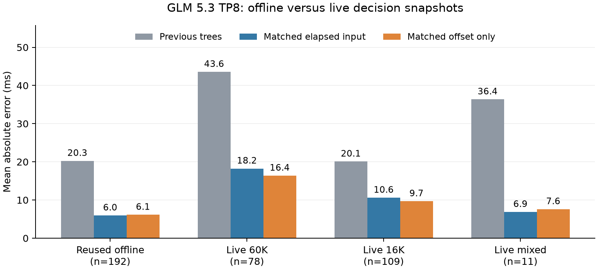

# Offset-only duration prediction: results and accuracy audit

GLM 5.3 TP8, concurrency 32, one output token. Each model/workload
uses four fresh-seed 75-request episodes. Startup, priming and
warmups are excluded. All 36 cells and 2,700 requests passed.

## Matched feature ablation on previous live data

<!-- markdownlint-disable MD013 -->
| Training data | Architecture | Elapsed input | MAE (ms) | Macro MAE (ms) |
| --- | --- | --- | ---: | ---: |
| original | trees | elapsed | 26.89 | 24.77 |
| original | trees | offset | 26.88 | 24.88 |
| original | mlp | elapsed | 38.51 | 55.10 |
| original | mlp | offset | 40.63 | 46.33 |
| live_aware | trees | elapsed | 17.55 | 14.93 |
| live_aware | trees | offset | 18.27 | 15.73 |
| live_aware | mlp | elapsed | 25.47 | 45.00 |
| live_aware | mlp | offset | 21.96 | 36.18 |
<!-- markdownlint-enable MD013 -->

The same rows, weights, capacities and seed are used in each paired
feature ablation. Complete workload/prompt-seed groups, including
all three predictor variants, are purged from held folds. These
previous live cells are now development data. No fresh live labels
are used in fitting or selection. Masking is applied to primary
and fallback models; only elapsed execution time is removed.

### Robustness across fitting seeds

Seeds 73–75 retain the same splits, rows and hyperparameters.
Only seed 73 checkpoints are served. Seeds 74 and 75 are CPU-only
sensitivity checks and do not consume fresh live labels.

<!-- markdownlint-disable MD013 -->
| Data | Model | Mean macro MAE (ms) | Min–max (ms) |
| --- | --- | ---: | ---: |
| original | trees_elapsed | 25.19 | 24.77–25.48 |
| original | trees_offset | 25.24 | 24.88–25.45 |
| original | mlp_elapsed | 47.21 | 38.81–55.10 |
| original | mlp_offset | 58.79 | 46.33–74.21 |
| live_aware | trees_elapsed | 14.89 | 14.62–15.14 |
| live_aware | trees_offset | 15.32 | 15.11–15.73 |
| live_aware | mlp_elapsed | 36.55 | 28.36–45.00 |
| live_aware | mlp_offset | 34.09 | 30.86–36.18 |
<!-- markdownlint-enable MD013 -->

## Fresh live throughput and TTFT

<!-- markdownlint-disable MD013 -->
| Workload | Predictor | req/s | Gain vs trees | Mean TTFT (ms) | p95 TTFT (ms) |
| --- | --- | ---: | ---: | ---: | ---: |
| familiar60k | trees | 6.363 | +0.00% | 4326.1 | 6019.6 |
| familiar60k | matched_elapsed | 6.477 | +1.79% | 4265.5 | 6055.9 |
| familiar60k | matched_offset | 6.856 | +7.75% | 4026.4 | 5477.8 |
| short16k | trees | 24.846 | +0.00% | 1116.6 | 1469.1 |
| short16k | matched_elapsed | 23.018 | -7.36% | 1212.9 | 1523.5 |
| short16k | matched_offset | 24.872 | +0.10% | 1111.3 | 1482.1 |
| heterogeneous | trees | 1.722 | +0.00% | 15582.3 | 21417.1 |
| heterogeneous | matched_elapsed | 1.722 | +0.03% | 15543.7 | 21430.5 |
| heterogeneous | matched_offset | 1.724 | +0.12% | 15583.0 | 21418.4 |
<!-- markdownlint-enable MD013 -->

### Offset-only versus matched elapsed-input control

<!-- markdownlint-disable MD013 -->
| Workload | Paired throughput gain | 95% interval |
| --- | ---: | ---: |
| familiar60k | +5.53% | [-11.52%, +25.85%] |
| short16k | +8.04% | [+0.02%, +16.70%] |
| heterogeneous | +0.09% | [-0.04%, +0.23%] |
<!-- markdownlint-enable MD013 -->

Intervals use four matched episode log ratios and a Student-t
interval with three degrees of freedom. This small study cannot
establish equivalence. The current tree baseline differs in fitting
data and architecture; matched controls isolate feature removal.
The tree control is the existing optimized deadline prototype,
not unoptimized vLLM.

## Accuracy on identical fresh live decision snapshots

<!-- markdownlint-disable MD013 -->
| Workload | Forecasts | Predictor | MAE (ms) | MAPE | Bias (ms) |
| --- | ---: | --- | ---: | ---: | ---: |
| familiar60k | 78 | matched_elapsed | 18.24 | 2.40% | -1.14 |
| familiar60k | 78 | matched_offset | 16.39 | 2.05% | -0.65 |
| familiar60k | 78 | trees | 43.57 | 6.50% | -19.15 |
| heterogeneous | 11 | matched_elapsed | 6.88 | 0.59% | -2.23 |
| heterogeneous | 11 | matched_offset | 7.60 | 0.63% | -2.31 |
| heterogeneous | 11 | trees | 36.37 | 2.62% | +31.79 |
| short16k | 109 | matched_elapsed | 10.61 | 5.41% | +2.24 |
| short16k | 109 | matched_offset | 9.67 | 4.84% | +1.92 |
| short16k | 109 | trees | 20.08 | 10.44% | -4.42 |
<!-- markdownlint-enable MD013 -->

All models are replayed at the same causal inputs sampled by the
union of live policies. A different issued-prediction population
must not be treated as an architecture accuracy comparison.

### How often the prediction deadline determines sealing

<!-- markdownlint-disable MD013 -->
| Workload | Predictor | Compute rounds | Prediction deadline | Fixed fallback deadline | Ready target |
| --- | --- | ---: | ---: | ---: | ---: |
| familiar60k | trees | 40 | 6 | 18 | 27 |
| familiar60k | matched_elapsed | 38 | 2 | 17 | 31 |
| familiar60k | matched_offset | 42 | 4 | 12 | 30 |
| short16k | trees | 43 | 4 | 9 | 31 |
| short16k | matched_elapsed | 41 | 3 | 16 | 32 |
| short16k | matched_offset | 43 | 3 | 9 | 34 |
| heterogeneous | trees | 100 | 0 | 104 | 5 |
| heterogeneous | matched_elapsed | 101 | 0 | 100 | 7 |
| heterogeneous | matched_offset | 98 | 0 | 97 | 5 |
<!-- markdownlint-enable MD013 -->

Counts include load-only sealing transactions, so compute rounds
are not a denominator for a seal percentage. Readiness or actual
compute completion can stop a hold before its predicted deadline.
The unchanged fixed hold path is recorded separately as 'deadline';
it must not be counted as a prediction-based sealing deadline.
This helps explain why lower forecast error need not increase
throughput in direct proportion to the accuracy improvement.

## Audit findings

Previous 215 issued forecasts reproduce exactly: zero nanosecond
prediction difference and zero input-feature difference. The new
audit also checks every issued value and its absolute deadline.
CPU exports matched research inference within 0.000001 ms on
215 prior live snapshots. Offset prediction passed 2,150 elapsed
invariance checks, including fallback and remaining-wait arithmetic.
The existing harness and predictor suite passed 211 tests with
8 skips; the updated predictor suite passed 31 tests.

The offline replay benchmark sampled close to GPU start (median
0.64 ms), with median zero concurrent loads and a maximum of eight.
Previous live 60K/16K predictions were made at median 52.3/15.5 ms
after GPU start, with median 8.5/7 concurrent loads. 46/92 60K
and 42/112 16K points exceed the old benchmark's load-count maximum.
The original training pool does include heavier loads; this is a
benchmark coverage gap, not wholly unseen training input.
Live prediction points are selected by open sealing transactions:
the previous run issued 215 forecasts across 558 compute rounds.
The mixed workload contributed only 11 forecasts across 295 rounds.
Offline collection sampled eligible batches independently of whether
the sealing policy would need a prediction. Accuracy on the decision
population must not be generalized to every compute batch.

Most live homogeneous batch geometries appeared in training
(88/92 60K and 104/112 16K). Matching geometry therefore does not
remove the discrepancy. GPU start/end polling uncertainty is
typically about 0.5–0.6 ms and is too small to explain tens of
milliseconds of error. The event-span target includes CPU
submission gaps and required output-copy joins. Submission and
transfer conditions differ even for matching geometries.

Masking elapsed in an already trained model improves some subsets
and harms others; it is not equivalent to retraining. Offline
errors remain different within comparable load and duration bins.
The observed coverage shifts do not yet provide a numerical causal
attribution of the entire gap. Feature ablations, data ablations
and per-snapshot replay are the controlled evidence here.

Timestamp reconstruction was checked separately. All 973 training
seal rows with an explicit feature-capture timestamp already use
that timestamp, rather than their later log timestamp. Evaluation
to logging adds a median 1.29 ms, but this lag is not added to those
training inputs. All 664 rows with a comparable saved raw feature
vector match exactly. The 1,235 new training shadow rows and all
192 benchmark rows record their capture time directly without
running a predictor. Older 2,786 seal rows lack an explicit capture
timestamp, so their timing offset cannot be recovered exactly.
This audit does not establish a timestamp bug in the checked rows.

### Checkpoint identity and the offline comparison

The audit evaluates the exact serving checkpoints on the reused
192-row offline benchmark. An architecture name alone does not
identify the fitted checkpoint. This table is descriptive; the
192-row benchmark is not a new independent test.

<!-- markdownlint-disable MD013 -->
| Previous serving checkpoint | Offline MAE (ms) |
| --- | ---: |
| trees | 20.25 |
| guarded_sparse_mlp | 5.13 |
| envelope_sparse_mlp | 4.24 |
<!-- markdownlint-enable MD013 -->

### Serving phase variation and controlled follow-up

Some 60K cells spent several seconds in load-only waits and GPU
gaps, with few actual compute predictions. These slowdowns occurred
under more than one predictor and were not explained by workload
position alone. The phase audit records the order, transfer bytes,
load turnaround, compute rounds, gaps and no-compute repeated holds.
Hold sums are not disjoint physical gap attribution.

All five 60K episodes below 6.2 req/s issue their first forecast
on the second compute batch. That 16–17-request membership has
already sealed before any prediction is issued in the episode.
This places the observed initial large-batch decision before the
first forecast. Some fast old-tree episodes also first forecast on
the second or third compute batch, so forecast ordinal alone does
not explain throughput. The phase audit preserves these sequences.

A follow-up gives every measured 60K episode an excluded common-tree
32-request same-workload episode, then resets and primes measured
caches separately. Three balanced rotations use fresh seeds
3301–3303 and the same frozen checkpoints. There are 225 measured
requests per predictor; the conditioning episodes are excluded.

<!-- markdownlint-disable MD013 -->
| Conditioned predictor | req/s | Mean TTFT (ms) | p95 TTFT (ms) |
| --- | ---: | ---: | ---: |
| trees | 6.217 | 4431.7 | 6083.7 |
| matched_elapsed | 6.159 | 4491.2 | 6027.8 |
| matched_offset | 6.430 | 4293.8 | 5512.2 |
<!-- markdownlint-enable MD013 -->

Paired offset-only versus elapsed-input gain: +4.31%
with a 95% interval [-33.23%, +62.96%].
This small study cannot establish equivalence or identify the
physical root cause of phase variation. It provides a separate
check against interpreting a single fast episode as predictor gain.
The common-tree conditioning episodes themselves vary in throughput:
the same conditioning procedure does not ensure identical physical
state. The follow-up report preserves every conditioning/measured
episode pair so that this remaining confound remains visible.
Follow-up details:
`/mnt/localnvme/glm53_offset_conditioned_20261008/FINDINGS.md`.

## Limits and artifacts

The serving preparation optimization, CPU private mapping, FP8 KV
and original sparse selector are preserved. No selector oracle or
transfer auditing runs during throughput measurement. This is a
prefill/TTFT study and does not establish long-generation performance.
The offset experiment is opt-in; the default checkpoint is unchanged.
Selected architecture: trees.
Allocation: 4053.7 seconds, server stopped.
All raw artifacts: `/mnt/localnvme/glm53_offset_predictor_20261008`.
